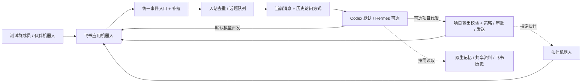

# 单测试群 AI 同事：设计草案

状态：方案已确认，本地实现与合成验证已完成主要路径；独立测试群的真实联调及试点评估尚待完成。本文保留设计目标，实际配置与操作以[运行与验证](../operations/single-group-ai-coworker.md)为准。

下一阶段的设计和验收范围见 [AI 同事原生运行时实施方案](ai-coworker-native-runtimes.md)。

后续修订：普通群主消息按群共享会话；发送方式在启动时固定，默认由模型直接发送，也可选择原有项目代发。直发协作使用任务标识与互相 @ 的轻量约定，不继承下文中项目代发的委派状态跟踪。发送方式切换时继续复用原会话，并注入本轮适用的发送说明。每次 daemon 启动固定选择 AI 同事或原影子业务模式，切换需停止、更新策略并重启；未运行模式的待办保留，审批截止时间继续流逝。

轻量化修订：每轮由程序提供当前消息、定位信息和访问方式；Agent 自主回看历史和按需读取共享记忆文件，不自动注入历史或文件正文。明确记住由主 Agent 自己操作；定期整理使用独立的新 Agent 会话，可以按需跨话题搜索。项目不验证直发或记忆写入是否发生，也无法约束 Agent 通过原生工具绕过项目门禁。下文保留的早期设计目标与本修订不一致时，以本修订及[运行与验证](../operations/single-group-ai-coworker.md)为准。

2026-11-18：P0 使用隔离临时配置、合成内容及真实 CLI，验证了 Codex 原生开发者指令，以及 Codex、Hermes 的同事输出和会话恢复；尚未在真实测试群验证，也未证明能即时写入 Codex 原生记忆。实现采用兼容 v9 数据的事务式升级，以及通用共享资料作为即时记忆的明确落盘路径。

本地实现相对下述完整目标仍有这些边界：

- 本地缓存查询按消息条数分页，缺少发送时间时按接收时间排序；远程工具由 Agent 按需调用，不受项目统一的时间或 token 预算约束。审计只记录本轮触发消息，不声称记录了 Agent 自行查询的完整历史。
- 未订阅飞书消息编辑和撤回事件，本地缓存可能滞后；当前触发消息在模型执行前获取最新可读正文，项目发送前再次比较正文指纹和可用修改时间，读取与发送并非原子操作。
- 后端恢复失败进入 `needs_review`，由操作员检查副作用后丢弃事件并显式重置；尚未可靠区分不可恢复和暂时性错误并自动建立新代次。
- 提供离线重建和回放已存事件的触发及上下文选择；它使用假后端，不复现真实模型决策、工具、投递、委派或已有 provider 会话。真实飞书权限、双机器人交接、原生记忆生成和基于真实试点的效果比较仍待验证。

## 1. 目标与已确认选择

在一个指定飞书测试群接入公开的 AI 同事。它以机器人身份参与，不默认代替用户表态或作出承诺。用户、其他群成员和可信伙伴机器人可以围绕同一话题协作。

- 真实联调先使用独立测试群，不默认接入日常群。机器人权限及长连接凭据仍需验证。
- 默认使用 Codex；Hermes 保留为可切换的后端。飞书事件、话题会话、任务、协作和项目自身的发送由本项目管理。
- 同一话题的成员共享模型会话，不因闲置自动重置；可以显式重置，后端确实无法恢复时创建新的会话代次。压缩上下文不等于创建新会话。
- 默认由 @ 触发，按需回看话题；另外提供可配置的持续理解模式。事件触发和历史来源是两个独立的配置维度。
- 支持主动 @ 已配置的伙伴机器人、等待结果并整合。对方是否响应取决于其应用权限、订阅和自身策略。
- 使用选中后端的原生配置、提示词、工具和记忆，不默认关闭。可附加一份明确配置的共享画像/项目上下文，并允许模型在有相应能力时搜索现有记忆。
- 支持后台自动从讨论中提炼记忆；明确要求“记住”时即时处理。首版不建设每个群各自独立的一套长期记忆系统。
- Codex 继承所选本机环境的原生权限，不额外限定工作目录。项目自身发出的飞书回复和委派继续经过项目策略和发送门禁；模型直接使用已有 CLI、MCP 或其他程序时，项目无法保证这些门禁。

这里的“试点 V1”是下述 P0–P4 的完整范围；各阶段可以先在本地或 dry-run 单独验收，不把阶段性可运行误称为完整交付。

## 2. 接入和后端选型

### 2.1 选择应用机器人，由项目承接飞书

使用能接收事件的飞书应用机器人。自定义 webhook 机器人主要用于发送，无法单独满足接收群消息及 @ 后执行的要求。测试时可使用专用测试应用，或复用现有应用，但同一应用的消息与卡片事件必须由一个统一接收入口分发，避免影响现有审批卡片。



现有 `CodexCliClient` 已封装非交互式运行、结构化输出和 session resume；因此首版直接复用 `codex exec`，不必增加 Hermes 中转。Hermes 作为同一后端接口的替代选项；不启动 Hermes 自己的飞书网关来重复接收事件。未来若有足够需求，再评估 Codex app-server 的进度、取消与工具交互能力。

当前项目还支持 Claude Code，新增模式不得破坏其既有行为。正式支持的后端仍遵循 [ADR 0002](../adr/0002-supported-agent-backends-must-be-complete.md) 的能力完整性约束。各后端的原生配置、记忆、恢复和非交互审批语义不同，不能假定切换后完全一致。

### 2.2 飞书权限及事件入口

至少验证：测试应用已启用机器人并加入指定群，能发送和回复；应用发布后实际取得消息读取、所需事件订阅及相应权限。不同需求的事件权限不同：

| 需要收到的事件 | 对应事件权限示例 | 用途 |
| --- | --- | --- |
| 群里人类 @ 本机器人 | `im:message.group_at_msg:readonly` | 默认触发 |
| 人类和其他机器人 @ 本机器人 | `im:message.group_at_msg.include_bot:readonly` | 伙伴机器人主动交接 |
| 群内人类和其他机器人的全部消息事件 | `im:message.group_msg.include_bot:read` | 本地连续记录或持续理解，包括非 @ 的机器人消息 |

具体权限、可见范围及生效方式以租户和飞书管理后台为准。仅有人类的群消息权限，不应假设能收到其他机器人的消息。事件权限也不等于历史查询权限；读取旧消息还要分别验证历史接口、机器人身份、成员资格和应用可见范围。机器人无法看到的历史不能靠 prompt 补齐。

可先用 `lark-cli event consume` 做有界接入验证，也可评估已有 `lark-channel-sdk`。生产中选择统一入口，消息与卡片回调复用接收及分发。同一应用存在多个长连接时不能假设每个连接都会收到每条事件；不得并行启动现有卡片连接、CLI 消息连接和 Hermes 连接并期待它们各收一份。

尽量把消息可靠入库后快速确认事件、随后异步执行模型。当前 SDK 的高层 `message` 回调可能在业务持久化前已经确认，不能仅靠注册回调就声称持久化优先；P0 必须验证低层回调是否满足此要求。若不满足，需实现可靠接收层，或明确采用有界丢失窗口加历史补拉，并验证补拉覆盖范围。

## 3. 话题会话与上下文

### 3.1 会话标识与生命周期

新增与任务分离的逻辑话题会话，关键标识包含应用、群、飞书话题和后端；每次重置或不可恢复后递增会话代次。每个代次保存后端 session ID、工作目录、状态和必要审计字段；任务、模型轮次和委派引用该话题会话。话题解析优先使用可验证的飞书 `thread_id`，结合 `root_id` 建立稳定映射；首次消息缺少 ID 或不同事件字段不一致时应通过消息详情核实，无法确定时标记待解析，不能悄悄把整个群并成一个会话。

同一话题的主轮次串行，避免同时 resume 同一个 session；Codex 后端通过 App Server 允许不同话题的主轮次并行，并允许主 Agent 自主委派原生后台子 Agent。主轮运行时的新消息可作为补充送入当前轮，主轮结束后新消息则开始同一会话的新轮；子 Agent 完成由项目持久化并唤醒所属主会话。Hermes 仍使用单工作线程，未接入上述后台子 Agent 能力。切换 provider 时不能把旧 provider 的 session ID 当成新 provider 的 ID；保留旧代次供诊断，新建代次并按需要读取飞书历史。会话恢复失败进入待核对，不因一次错误自动重置。完成一个任务或伙伴委派不删除共享话题会话。

现有 session 属于 task，且续轮通常只注入当前消息；现有 owner 发言还可能触发 `human_taken_over`。新模式需要独立语义：群主是普通协作者；将旧消息用作上下文时不能重新当作实时事件路由，避免触发接管或重复执行。保持原影子助手模式的行为兼容。

### 3.2 两个独立维度

以下为当前配置语义：

1. `trigger_mode`: `mention`（默认，收到 @ 才启动模型）或 `followups`（已关注话题出现后续消息时也可启动模型判断，是否发言另由输出与发送策略决定）。伙伴委派的匹配结果属于可配置的显式唤醒事件。
2. `history_source`: `live_on_demand`（需要时调用飞书读取）或 `local_cache`（持续接收并保存可见消息，需要时选择读取；缺口可按策略回源补拉）。

| 触发 | 来源 | 实际行为 |
| --- | --- | --- |
| `mention` | `live_on_demand` | 默认组合：@ 时仅提供当前消息，Agent 可按需查询话题或群历史。 |
| `mention` | `local_cache` | 可见事件进入缓存，但不因普通消息立即调用模型；@ 时 Agent 可选择查询缓存，缺口可有限补拉。缓存不等于模型已经读过。 |
| `followups` | `live_on_demand` | 通过订阅或轮询发现关注话题的新消息，再按需读取上下文并判断是否需要发言；不要求把所有消息长期存本地。 |
| `followups` | `local_cache` | 收取并缓存可见事件，新消息可触发判断；每轮只选相关上下文，模型并非无条件回复。 |

持续接收和持续调用模型不是同一件事；持续理解即使采用实时回看也需要事件或轮询来发现新消息。缓存只能覆盖成功接收且有权限的消息，断连、上线前历史、租户限制、撤回/编辑和分页上限都可能造成缺口。需要记录来源、覆盖区间、获取失败、分页是否还有更多，以及可恢复的水位；不能把“缓存为空”当作“群内没有讨论”。

### 3.3 具体例子

同一话题中：09:00 小李说“准备演示”；09:05 小何说“截止周五”，没有 @；09:06 Box 机器人说“构建成功”，没有 @；09:10 小李 @ AI 同事“总结一下”；09:12 小何改口说“改到下周一”，没有 @；09:13 小何再次 @ AI 同事“变化是什么”。

- 默认 `mention + live_on_demand`：09:10 才启动模型。若实时读取接口和权限覆盖上述消息且都在选择窗口内，模型可看到演示、周五和构建成功；否则只能看到成功取得的部分，并应报告缺口。09:12 不会自动进入会话；09:13 触发后可回看并发现日期变更。
- `mention + local_cache`：09:05/09:06 可先记录，09:10 Agent 可自主查询；如果应用缺少接收其他机器人消息的权限，09:06 仍可能缺失。09:12 被记录不代表模型已看到，09:13 再按需查询。
- `followups + live_on_demand`：关注已经建立且订阅权限覆盖时，09:12 可唤醒模型，重新读取相关上下文；模型可判断变化需要通知，也可以不发言。仅搜索历史本身无法主动发现新消息。
- `followups + local_cache`：09:12 到达后可以缓存并触发模型判断，09:13 同样复用已有话题会话。相同消息由事件和补拉重复取得时只能处理一次。

每轮实际看到的内容由**后端保留的先前会话（可能已压缩）＋当前消息＋原生自动上下文＋模型主动读取的资料和工具查询结果**共同决定。共享 session 不等于每条群消息都自动进入模型；重置 session 后按需回看又可能重新读到旧消息。普通群中另一个话题不会仅因会话共享而自动加入，但原生记忆、配置的资料或模型主动搜索可能带来跨话题信息。

本地缓存查询按配置条数分页并返回 `has_more` 与已知缺口，Agent 可继续搜索或分页。项目审计触发消息，不自动记录 Agent 使用原生工具读过的全部内容。撤回、修改、部分消息类型和附件受实际可见性限制；此前已进入模型会话的内容无法仅靠本地删除而保证从后端历史中消失。

## 4. 记忆与“像我”

| 层次 | 保存什么 | 何时进入模型 |
| --- | --- | --- |
| 飞书历史 / 可选缓存 | 按时间排列的原始讨论 | 通过本轮回看、选择或主动搜索 |
| 话题模型会话 | 已送入该 provider 的对话和工具轨迹，可能压缩 | 恢复该会话时由 provider 管理 |
| 后端原生长期记忆 | provider 自己维护的偏好、经历和项目知识 | 依 provider 的原生加载与搜索机制 |
| 可选共享画像/项目资料 | 显式配置且可编辑的通用背景 | 根据配置加载或按需读取 |

Hermes 有其原生提示词和记忆，Codex 也有原生上下文和记忆；哪个更像用户取决于实际积累、是否能加载和检索，以及评测场景，不能根据品牌、提示词长度或文件大小判断。用同一批脱敏问题和同等可见资料比较任务正确率、偏好一致性、证据引用和不确定性表达，记录模型、session 与资料差异。

本机 Codex 的 memories 功能已启用，但当前用户配置中的 `memories.disable_on_external_context=true` 可能使涉及外部上下文的会话不参与自动记忆生成；这是当前机器检查结果，不代表其他环境。先通过合成会话验证选定模式是否使用原生记忆、是否生成、等待条件与作用域，再决定是否只对 AI 同事运行覆盖相关配置。项目当前 `config_scope: isolated` 和部分后端的 `auto_context: disabled` 可能屏蔽用户需要的原生配置或记忆；不同 provider 的 flag 语义不同，不能一概而论。

尤其要区分：当前 Hermes 的 `--ignore-rules` 会跳过其自动规则和记忆，而 Codex 的同名 flag 只针对 execpolicy 规则，并不等于关闭 AGENTS、skills、MCP 和记忆。另外，当前 Codex Task Session 使用 `-c developer_instructions=...` 指定固定指令；CLI 覆盖值可能替代用户在配置中设置的同名字段。AI 同事需要在 P0 检查有效指令和结构化输出的共存方式，不能仅移除 `--ignore-user-config` 就认定完整继承。

后台按收到的活动和时间间隔启动独立 Agent，自行决定搜索哪些话题以及如何维护通用共享资料；明确要求“记住”时由主 Agent 使用工具处理。提示词要求区分来源与时间并在写入后才确认，但项目不强制结构、不验证原生工具的文件操作是否成功。尚未验证 Codex 稳定的即时原生记忆写入接口；共享资料也不是每群一套记忆。

后台进程应避免把临时猜测当成稳定事实；对矛盾信息保留来源和时间。长期记忆和原生后端记录可能跨群、跨任务被后续会话读取；公开群里的机器人仍应区分用户个人偏好、群内事实和他人主张，不能把私人或未经证实的信息当作用户对外承诺。

## 5. 伙伴机器人协作

模型产出结构化委派意图：目标伙伴、同一话题中的子任务、必要上下文和预期结果。项目校验目标处于该群的伙伴 allowlist，构造飞书实际 @，以回复/话题形式发送。现有发送层会过滤模型生成的任意 @ 标记，因此不能仅要求模型在普通文本中拼 `@Box`；需要新增受控的委派输出和发送路径。

1. 为每次委派保存唯一关联 ID、目标机器人、话题、请求消息 ID、截止时间及状态。
2. 在已接入事件和权限允许时接收伙伴结果；验证来源、话题和回复关联。若对方不携带关联 ID，采用经验证的消息回复关系匹配；无法唯一对应时不冒认结果。
3. 结果入队后唤醒同一话题会话整合；等待期间不占用正在运行的模型进程或整个 daemon。超时、失败、对方未订阅或无权限时明确报告，可由人继续处理。
4. 对重复事件和重试做幂等；限制链路跳数、同一话题的并发委派和触发频率，避免两个机器人互相无限 @。只把自身机器人消息排除出正常触发，不应把所有 `sender_type=bot` 都误认成自己。

例如小李 @ AI 同事“制作演示并检查构建”→ AI 同事调用本机 Codex 分析并 @ Box 请求构建状态 → Box 回报构建成功及证据 → 系统关联该结果并恢复 AI 话题会话 → AI 同事给小李汇总。对方未回复时只能报告等待或超时，不能推测构建成功。

事件和补拉入口以应用、消息及 revision 等稳定标识去重。模型调用、SQLite 和飞书发送无法组成单一事务：崩溃或发送超时后若无法确认模型或飞书侧是否已执行，必须记录待核对状态并先查询或交由人工处理，不能盲目重跑有本机副作用的模型轮次或重复发送。明确保障的幂等范围只覆盖项目能够识别和管理的动作，不覆盖模型直接运行的外部工具。

## 6. 与现有项目的具体衔接

| 位置 | 拟议变化 |
| --- | --- |
| `config.py` / Product Policy Store / settings | 增加单群模式、触发、来源、伙伴和预算配置；运行时仍以 Product Policy Store 为准，`config.yaml` 通过现有导入流程生效。配置迁移、operator 可见性和文档同步。 |
| `feishu/lark_cli.py` / 接收层 | 显式支持 bot 身份下的历史查询和消息回复；现有部分历史查询固定 `--as user`，不静默退回个人身份。接入单一消息/卡片入口，补拉及失败状态。 |
| `message_normalization.py` / `ingestion.py` | 区分自身 bot、可信伙伴和普通成员；将实时事件处理与只读历史组装分开，避免旧消息触发路由副作用。 |
| `routing.py` / `task_session_runner.py` | 同一话题长期共享独立 session；历史按预算注入，轮次按话题排队；shadow 模式及原 task session 语义保持兼容。 |
| `store/schema.sql` / `store/schema.py` | 持久保存话题会话、入站处理状态、子 Agent、伙伴委派与必要的覆盖/缺口数据；v9 和 v10 到 v11 使用事务式增量升级，复用现有消息、任务、发送幂等和 retention 能力。 |
| `codex.py` / `hermes.py` | 为 AI 同事支持经验证的原生配置及会话能力；Codex 当前 `read_only` 和 `full_access` 都不等于继承环境，需明确新增 `inherit` 或等价的运行方式。不同 provider 不支持时 health 明确报出，不能伪装成等价。更新与 ADR 0002 冲突的设计决策。 |
| `processing.py` / prompt / 输出契约 | 定义同事身份、有限的结构化动作和伙伴委派，复用可用的权限、approval、dry-run 和 idempotency；新 prompt 纳入现有版本及审计规则。 |
| `daemon.py` / health / CLI | 接收与慢模型执行解耦；健康检查覆盖 bot 权限、单连接、会话恢复、队列积压和缓存缺口；已有卡片回调与 shadow 路径须回归。 |

`inherit` 的含义是让 provider 使用选定环境的原生设置，不偷偷增加 `read-only` 或 `dangerously-bypass`。Codex 非交互模式对等待审批的处理要实测：避免 daemon 无期限挂起，超时或需要人工介入时准确报告。既不为通过测试降权，也不把“继承原生设置”宣称为无权限限制。

配置形态示意如下，**不是当前可直接运行的配置**；实际归属以 Policy Store 和实现为准：

```yaml
ai_coworker:
  enabled_for_chat: oc_test_group
  trigger_mode: mention                 # mention | followups
  history_source: live_on_demand       # live_on_demand | local_cache
  session_scope: thread_shared
  session_expiry: none
  backend: codex
  native_context: true
  tool_permissions: inherit
  partner_bots: []                     # 显式配置可委派目标
  memory_maintenance: auto
```

## 7. 分阶段实施与验收

### P0：能力与边界验证

- 用合成数据确认 Codex 在项目启动方式下原生配置/记忆加载、resume、非交互权限、记忆生成和明确记住的持久化能力；不读取或输出真实私人记忆内容。
- 核对当前测试应用事件权限、历史 bot 身份、真实群话题字段、双方机器人互相 @ 的事件可见性。不能取得租户授权时记录缺口，不宣称已验证。
- 用 SDK 原始回调或 CLI 试验确认接收、应答、重连和补拉的边界；确定统一入口和现有审批卡片共存方式。
- 明确与 ADR 0002 权限模式及 ADR 0012 对代码门禁覆盖范围的修订；保留实际用户选择的原生权限边界。

### P1：基础同事和共享话题会话

- 单群开关、公开身份、`mention + live_on_demand`、bot 身份读取、话题会话持久化与串行、恢复及不可恢复处理。
- 实现经验证的原生 Codex 运行、共享资料读取、明确记住的可验证持久化；保留现有后端和 shadow 默认行为。
- 接入现有发送校验、健康检查、dry-run、policy 及可配置审批；先在假客户端和本地回放验收，再做单群试点。

### P2：伙伴机器人委派

- 结构化委派、伙伴 allowlist、真实 @、状态和关联、事件去重、超时恢复和循环抑制。
- 同群真实验证一次成功交接和一次超时；如果平台或对方配置不能响应，明确为接入未通过，而不是以假客户端通过替代真实能力。

### P3：两维配置完整覆盖

- 引入本地连续缓存、缺口检测和补拉；加入关注话题的 `followups` 判断。验证四种组合均与第 3 节语义一致。
- 确认重连、离线、重复、乱序、编辑/撤回、分页和附件失败时的可观察状态；保持按需选择而非把全部缓存送入模型。

### P4：长期记忆整理与试点评估

- 验证原生后台记忆能覆盖试点要求；不足时实现单会话后台整理及持久化的可观察结果。支持自动新增、去重和冲突处理。
- 在同等输入条件下比较 Codex/Hermes，并使用项目已有 eval 思路增加无网络副作用的生产输入回放；观察多成员续问、未 @ 变化、伙伴失败、不可恢复的 session 与原生记忆影响。
- 同步操作文档、权限说明、迁移/回退方案和测试记录。P0 未解决的真实环境限制应在交付中显式列出。

每一阶段以定向单测和相关回归为基本门槛；涉及状态、策略或路由时补完整测试。最终依仓库要求运行相关 pytest、Ruff、格式和 Pyright，必要时检查打包与 Console。真实飞书仅在准备好测试应用、群和权限后进行，先 doctor 和 dry-run，再按已确认的群策略验证。

## 8. 验证边界与参考

- 本文对源码、官方文档和本机 CLI 的静态检查不等于完成真实飞书联调。具体权限、机器人间互收、补拉完整性和 native memory 行为需要 P0/P2 实测。
- 本项目可保证自己控制的发送路径执行既有门禁；继承原生权限的 Codex 仍可能直接操作其账户可访问的本机资源和外部系统，项目无法对这部分提供拦截保证。
- 飞书：[接收消息事件及权限](https://open.larkenterprise.com/document/uAjLw4CM/ukTMukTMukTM/reference/im-v1/message/events/receive)、[长连接订阅](https://open.feishu.cn/document/ukTMukTMukTM/uYDNxYjL2QTM24iN0EjN/event-subscription-configure-)。
- Codex：[非交互执行](https://developers.openai.com/codex/noninteractive/)、[原生记忆](https://learn.chatgpt.com/docs/customization/memories)。
- 记忆整理参考：[Anthropic 对 agent memory 和 dreaming 的研究](https://www.anthropic.com/research/components-of-agent-memory)。其思路是异步整理经验，不意味着必须引入其多 agent 架构。
